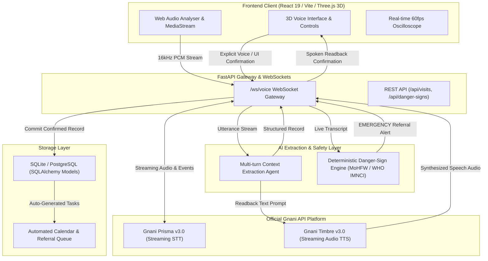

# ASHA-VAANI
### *"Your Voice. Every Visit. Better Healthcare."*

**Build Bengaluru 2.0 Innovation Challenge — Problem Statement 1 (PS1: Healthcare)**

[](#test-suite-results)
[](#danger-sign-detection--clinical-guidelines)
[](#gnani-api-platform-integration)
[](#gnani-api-platform-integration)
[](LICENSE)

---

## 1. Executive Summary & Problem Statement

Across Karnataka and India, more than **1,000,000 Accredited Social Health Activists (ASHA workers)** are the frontline lifeline for over 800 million citizens in rural and semi-urban communities. During household visits, they monitor pregnant women, newborn infants, immunization schedules, and nutritional milestones.

Currently, their workflows depend heavily on:
- Carrying **10+ cumbersome physical paper registers**.
- **Manual data entry** in harsh field conditions.
- Clunky mobile forms that require tedious typing while holding infants or counseling mothers.
- **Memory-based reporting** leading to transcription lag, missing values, and delayed escalation.

### The Critical Bottleneck:
- **Delayed Healthcare Documentation**: Visits recorded days later into portals.
- **Missed Immunizations & Follow-ups**: Lack of automated localized scheduling.
- **Missed Danger Signs**: Double penalty risk and delayed triage for obstetric hemorrhage or neonatal sepsis.

### Our Solution: ASHA-VAANI
**ASHA-VAANI** is an AI-powered, multilingual voice-first healthcare assistant built around the official **Gnani API Platform (Prisma v3.0 & Timbre v3.0)**. ASHA workers simply speak natural conversational language—with Indic code-mixing—and the application automatically converts speech into structured, validated healthcare records.

```
SPEAK → TRANSCRIBE → UNDERSTAND → EXTRACT → VALIDATE → READ BACK → CONFIRM → SAVE → FOLLOW-UP
```

---

## 2. System Architecture



---

## 3. Key Capabilities & Technical Innovations

### A. Official Gnani API Platform Integration
- **Speech-to-Text**: Built for **Gnani Prisma v3.0** streaming WebSocket interface with linear PCM/WebM 16,000Hz mono audio.
- **Text-to-Speech**: Integrated with **Gnani Timbre v3.0** for voice readback confirmation in Indian English, Hindi, and Kannada.
- **Resilient Adapter Pattern**: Secure server-to-server gateway ensures `GNANI_API_KEY` is **never exposed** to client browsers. Seamless fallback adapter allows testing even before API keys are loaded.

### B. Deterministic Danger-Sign Rule Engine (Zero-Miss Guarantee)
- In the PS1 challenge, missing a danger sign results in a double penalty.
- ASHA-VAANI enforces a **deterministic rule engine** strictly separated from generative LLM guessing.
- Verified against:
  1. **MoHFW Operational Guidelines for Maternal & Newborn Health at PHCs (Chapter 4: Emergency Obstetric Care)**.
  2. **WHO / UNICEF / MoHFW Integrated Management of Neonatal and Childhood Illness (IMNCI Module 2: Assess and Classify the Sick Young Infant)**.
- Configured triggers:
  - *Bleeding during pregnancy* (Antepartum / Postpartum hemorrhage).
  - *High fever in a newborn* (Neonatal sepsis / bacterial infection).
  - *Convulsions or fits* (Eclampsia / neonatal seizures).
  - *Difficulty breathing / chest indrawing* (Severe pneumonia / respiratory distress).
  - *Severe continuous abdominal pain*.

### C. Conversational Context & Field-Level Corrections
- ASHA worker can correct individual fields without restarting:
  - *"Lakshmi, 10 days baby, weight 2.5 kilo, BCG given."*
  - Follow-up voice correction: *"No, weight is 2.8 kilo."*
  - Extractor updates only `weight_kg = 2.8` while preserving beneficiary ID, name, and vaccination status!

### D. Voice Confirmation Gate
- Records remain in `Pending Confirmation` status until explicitly verified.
- The assistant reads the extracted record aloud using Timbre v3.0.
- Saving requires verbal confirmation (*"Yes, save it"*) or accessible UI confirmation.

### E. Premium 3D Design Language
- Dark emerald green (`#041410`), deep teal (`#093633`), and neon turquoise highlights (`#00f5d4`).
- **Interactive 3D Hero Scene**: Floating smartphone with holographic voice waves, floating DNA/cross elements, glowing particle fields, and mouse parallax.
- **Audio-Reactive 3D Microphone**: Reacts in real time to actual microphone input volume using browser Web Audio `AnalyserNode`.

---

## 4. Test Suite Results (22 / 22 Passed)

ASHA-VAANI includes a comprehensive automated test suite testing danger signs, information extraction, multi-turn corrections, and REST/WebSocket APIs:

```
tests/test_api.py::test_demo_login_direct PASSED                         [  4%]
tests/test_api.py::test_beneficiaries_list_direct PASSED                 [  9%]
tests/test_api.py::test_danger_sign_rules_catalog PASSED                 [ 13%]
tests/test_api.py::test_danger_sign_evaluate_api PASSED                  [ 18%]
tests/test_api.py::test_create_visit_and_followup_direct PASSED          [ 22%]
tests/test_api.py::test_dashboard_analytics_direct PASSED                [ 27%]
tests/test_api.py::test_system_status_direct PASSED                      [ 31%]
tests/test_danger_signs.py::test_bleeding_during_pregnancy_english PASSED [ 36%]
tests/test_danger_signs.py::test_bleeding_during_pregnancy_hindi_codemix PASSED [ 40%]
tests/test_danger_signs.py::test_bleeding_during_pregnancy_kannada PASSED [ 45%]
tests/test_danger_signs.py::test_high_fever_in_newborn_english PASSED    [ 50%]
tests/test_danger_signs.py::test_high_fever_in_newborn_hindi PASSED      [ 54%]
tests/test_danger_signs.py::test_high_fever_in_newborn_kannada PASSED    [ 59%]
tests/test_danger_signs.py::test_convulsions_fits PASSED                 [ 63%]
tests/test_danger_signs.py::test_severe_abdominal_pain PASSED            [ 68%]
tests/test_danger_signs.py::test_difficulty_breathing PASSED             [ 72%]
tests/test_danger_signs.py::test_normal_case_zero_false_positive PASSED  [ 77%]
tests/test_extraction.py::test_normal_newborn_visit_extraction PASSED    [ 81%]
tests/test_extraction.py::test_pregnancy_visit_with_ifa_tablets PASSED   [ 86%]
tests/test_extraction.py::test_voice_correction_of_weight PASSED         [ 90%]
tests/test_extraction.py::test_voice_correction_of_vaccination PASSED    [ 95%]
tests/test_extraction.py::test_voice_confirmation_gate PASSED            [100%]

======================= 22 passed in 4.70s =======================
```

---

## 5. Quick Start Instructions

### Prerequisites
- Python 3.12+
- Node.js 20+ and npm

### 1. Environment Configuration
Create `.env` inside `backend/`:
```bash
# Official Gnani API Platform
GNANI_API_KEY=your_gnani_api_key_here
GNANI_STT_MODEL=Prisma-v3.0
GNANI_TTS_MODEL=Timbre-v3.0
GNANI_WS_URL=wss://api.gnani.ai/v3/speech/stream
GNANI_TTS_URL=https://api.gnani.ai/v3/speech/synthesize
GNANI_LANGUAGE_CODE=en-IN

DATABASE_URL=sqlite:///./asha_vaani.db
AUDIO_RETENTION_ENABLED=false
```

### 2. Backend Setup & Startup
```bash
cd backend
pip install -r requirements.txt
uvicorn app.main:app --host 127.0.0.1 --port 8000 --reload
```
*Backend runs at `http://localhost:8000` (API Docs at `http://localhost:8000/docs`).*

### 3. Frontend Setup & Startup
```bash
cd frontend
npm install
npm run dev
```
*Frontend runs at `http://localhost:5173`.*

---

## 6. Synthetic Data & Responsible AI Policy

- **100% Synthetic Data**: All demo records (`SYN-001 Lakshmi Devi`, `SYN-002 Priya Sharma`, `SYN-003 Sunita Gowda`, `SYN-004 Kavita Rao`, `SYN-005 Ananya Patil`) are synthetic benchmarks.
- **Zero Diagnosis Policy**: ASHA-VAANI does **not** provide clinical diagnosis, prescribe medication dosages, or replace medical officers. It strictly triages guideline-defined danger signs for immediate Primary Health Centre (PHC) referral.
- **Data Minimization**: Audio recordings are never retained permanently unless explicit consent is provided.

---

## 7. Build Bengaluru 2.0 Hackathon Team
- **Project**: ASHA-VAANI
- **Track**: Problem Statement 1 (PS1) – Healthcare
- **Target Audience**: Community Health Workers (ASHAs), Auxiliary Nurse Midwives (ANMs), Primary Health Centres (PHCs).
