# ASHA-VAANI Technical Architecture Blueprint

## System Overview
ASHA-VAANI ("Your Voice. Every Visit. Better Healthcare.") is an AI-powered voice assistant designed for Indian community health workers (ASHAs) during maternal, newborn, and infant household visits.

```mermaid
flowchart TD
    subgraph Client["Frontend Client (React 19 / Three.js)"]
        UI[3D Voice Assistant UI]
        Audio[Web Audio AnalyserNode / MediaStream]
        WSClient[WebSocket Voice Client]
    end

    subgraph Gateway["FastAPI Server & WebSocket Gateway"]
        WSHandler["/ws/voice Handler"]
        RESTRouter["REST API Endpoints (/api/*)"]
    end

    subgraph GnaniCloud["Official Gnani API Platform"]
        Prisma["Gnani Prisma v3.0 (Streaming STT)"]
        Timbre["Gnani Timbre v3.0 (Streaming TTS)"]
    end

    subgraph AI["Healthcare AI Orchestration Engine"]
        Extractor["Extraction Agent (Multi-turn Context)"]
        RuleEngine["Deterministic Danger-Sign Rule Engine (Zero-Miss Policy)"]
    end

    subgraph DB["Storage Layer"]
        SQLite["SQLite / PostgreSQL (SQLAlchemy Models)"]
    end

    Audio -->|PCM / WebM Streaming| WSHandler
    WSHandler <-->|Real-time Audio & Chunks| Prisma
    WSHandler -->|Transcript| RuleEngine
    RuleEngine -->|Emergency Triage Alert| WSHandler
    WSHandler -->|Utterance + Context| Extractor
    Extractor -->|Structured Healthcare JSON| WSHandler
    Extractor -->|Spoken Readback Text| Timbre
    Timbre -->|Synthesized Audio Stream| WSHandler
    WSHandler -->|Voice Readback Confirmation| UI
    UI -->|Explicit Voice/UI Confirmation| WSHandler
    WSHandler -->|Commit Confirmed Record| SQLite
    SQLite -->|Auto-Generated Tasks| RESTRouter
```

---

## 8-Stage Voice-to-Record Workflow
1. **SPEAK**: ASHA worker speaks natural Indic language with English code-mixing.
2. **TRANSCRIBE**: Audio chunks are streamed to Gnani Prisma v3.0 for real-time transcription.
3. **UNDERSTAND**: Multi-turn conversational context is maintained per household visit.
4. **EXTRACT**: Fields extracted into structured JSON (Beneficiary ID, name, visit type, weight kg, vaccinations, next visit date).
5. **VALIDATE**: MoHFW & WHO IMNCI deterministic rule engine verifies danger signs and numeric validity.
6. **READ BACK**: Spoken summary generated and read aloud via Gnani Timbre v3.0.
7. **CONFIRM**: Record remains in `Pending Confirmation` until explicit "Yes, save it" is voiced or confirmed in UI.
8. **FOLLOW-UP**: Next visit automatically creates scheduled calendar follow-up tasks and referral alerts.

---

## Privacy & Audio Retention Policy
- Audio is processed transiently in memory.
- `AUDIO_RETENTION_ENABLED=false` by default.
- Synthetic beneficiary identities (`SYN-001` through `SYN-005`) prevent PII exposure.
